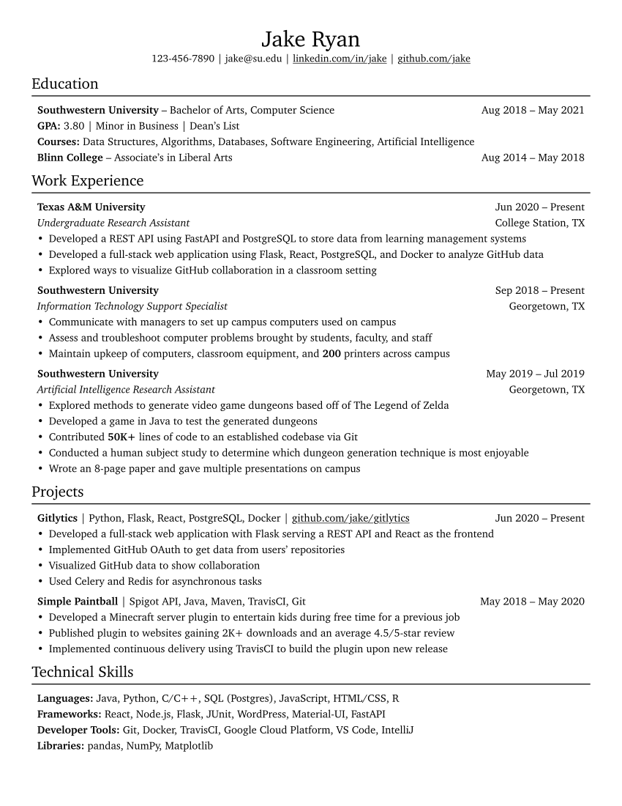

# Resume

## Overview

This repo is a mini-project that builds your resume using typst, a typesetting
language similar to LaTeX. The output is similar to Jake's resume, all without
needing to mess with LaTeX!

## Instructions

1. Copy over the project via.

```
git clone https://github.com/daviliuu/ResumeBuilder.git
```

2. Download typst and [uv](https://docs.astral.sh/uv/) for your operating system:

#### Windows

```
winget install --id Typst.Typst
winget install --id=astral-sh.uv -e
```

#### Mac 
```
brew install typst uv
```

#### Ubuntu
```
sudo apt install typst
curl -LsSf https://astral.sh/uv/install.sh | sh
```

#### Arch
```
sudo pacman -S typst uv
```

3. Modify the config.json file to fit your profile! You can add or remove the 
education, experiences, skills, or projects sections! It's fairly modular, 
with required sections marked as "Required" if you choose to include the 
section in your resume. i.e. the name of the school, graduation date, and 
degree program are required fields if you choose to include an *Education* 
section on your resume.

4. Run the project via uv
```
uv run resume
```

5. Compile the typst code into a pdf file
```
typst compile resume.typ
```

## Example

`example-config.json` is a filled-in sample based on
[Jake's Resume](https://github.com/jakegut/resume). To build it:

```
uv run resume --path example-config.json
typst compile resume.typ
```


